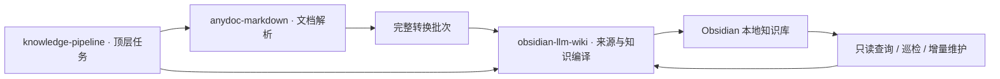

# Knowledge Pipeline Skills

[](https://github.com/nanzhipro/knowledge-pipeline-skills/actions/workflows/ci.yml)
[](LICENSE)

一个仓库，三个可分别调用的 Agent Skills：多格式文档解析、Obsidian 本地知识维护，以及两者的顶层编排。基于作者自己的 Karpathy LLM Wiki 工作流，不引入 OKF。

| Skill | 独立任务 | 输入 → 输出 |
| --- | --- | --- |
| [`anydoc-markdown`](skills/anydoc-markdown/SKILL.md) | 只做文档解析 | 文件或目录 → 标准 Markdown、原件、附件、报告与 manifest |
| [`obsidian-llm-wiki`](skills/obsidian-llm-wiki/SKILL.md) | 建库、导入、查询与维护 | 完整转换批次 → 可追溯、持续演进的本地 Wiki |
| [`knowledge-pipeline`](skills/knowledge-pipeline/SKILL.md) | 按目标编排端到端任务 | 原始文档或已转换批次 → 检查、知识编译与已授权发布 |



解析技能可单独安装使用；Wiki 技能可直接接收既有转换批次，无需安装解析器或顶层技能。端到端编排需要同时安装它所调用的子技能。顶层会按任务选择阶段：只有查询时直接使用 Wiki，只有解析时直接使用解析技能。

## 安装

```bash
gh repo clone nanzhipro/knowledge-pipeline-skills
```

把 `skills/` 中所需的完整 Skill 文件夹放入 Agent 的技能目录，例如项目 `.agents/skills/`。完整管线安装三个文件夹，已有同名安装先保留备份；本仓库不要求安装为一个插件。

- 解析：Rust/Cargo **1.88+**，当前锁定 Rust anydoc **0.2.4**。首次构建需要联网取依赖，转换本身本地运行。
- Wiki：Python **3.10+** 与 `skills/obsidian-llm-wiki/requirements.txt`，无模型 API Key、后台模型服务或 Obsidian 插件依赖。
- 顶层：使用 Agent 的任务执行能力，按阶段调用子技能；它不复制解析器或 Wiki 工具代码。

macOS：

```bash
python3 -m venv .venv
.venv/bin/python -m pip install -r skills/obsidian-llm-wiki/requirements.txt
```

Windows PowerShell：

```powershell
py -3 -m venv .venv
.\.venv\Scripts\python.exe -m pip install -r .\skills\obsidian-llm-wiki
equirements.txt
```

## 调用示例

完整任务：

> 使用 `$knowledge-pipeline`，把 `/path/to/documents` 整理到 `/path/to/my-vault`，collection 为 `research-library`，中文知识库。逐份阅读来源，维护概念、未决分歧和概览，检查差异后发布。

三个独立入口：

> 使用 `$anydoc-markdown`，只把这个文档目录转换到新的输出目录，保留完整原件、附件和解析限制。

> 使用 `$obsidian-llm-wiki`，接收已有的 anydoc 输出，增量维护这个本地库，保留历史证据和手工编辑。

> 使用 `$knowledge-pipeline`，只查询现有库里的……，打开完整页面并引用来源，不归档答案。

实际文件工作流：`workspace → import → Agent 语义编译 → prepare → diff → apply`。完整写入授权下可完成发布；仅要求准备时停在 diff。原始快照不可改写，正式库发生外部修改时停止并重新协调。

需要直接使用 CLI 时：

```text
cargo run --locked --release --manifest-path skills/anydoc-markdown/scripts/anydoc-md/Cargo.toml -- convert INPUT --output OUTPUT
cargo run --locked --release --manifest-path skills/anydoc-markdown/scripts/anydoc-md/Cargo.toml -- verify OUTPUT
python skills/obsidian-llm-wiki/scripts/wiki.py --help
```

知识内容由 Agent 阅读证据后编写。单独导入只产生待编译来源卡片。`partial` 保留限制，OCR、损坏及不支持文件留下诊断，不被编造为知识。

## 验证与过程

三个 Skill 分别为 **95 / 91 / 95 分**；原生 CI 三个平台、六组 Python 组合全部通过。当前三个独立 Skill 的 Plugin Eval、官方 Agent Skills 校验和源码清单见 [整合评测](docs/evaluation/merge/README.md)。它们是静态包质量分数，不是事实正确率或模型理解准确率。

[原生 CI](https://github.com/nanzhipro/knowledge-pipeline-skills/actions/workflows/ci.yml) 在 macOS ARM/Intel 与 Windows x64 分别测试 Rust，并在 Python 3.10/3.13 上运行 Wiki 回归和真实解析器到 Wiki 的交接测试。顶层 Agent 的实际知识编译演练单独留证，见 [验证范围](docs/validation.md)。未运行 Obsidian GUI 自动化。

```bash
python -m pip install -r requirements-dev.txt
cargo test --manifest-path skills/anydoc-markdown/scripts/anydoc-md/Cargo.toml --locked
python -m unittest discover -s skills/obsidian-llm-wiki/tests -v
# 先构建 Rust release 二进制，再运行真实交接测试：
cargo build --manifest-path skills/anydoc-markdown/scripts/anydoc-md/Cargo.toml --locked --release
python -m unittest discover -s tests -v
```

多文件发布不是原子事务；工具锁只约束本工具。中断后使用 Wiki 恢复流程，未知外部修改不会被强行覆盖。检索缓存只定位候选，引用需回到正式页面与原文。

## 合并与许可

[迁移记录](docs/migration/README.md) 保存两个原仓库的提交映射、原始标签、可恢复 Git bundle、Release 资产和历史 CI 备份索引。原始报告在 [组件历史证据](docs/components/README.md) 保留原值。新仓库统一发布，三个调用名保持独立。

聚合发行版本为根 `VERSION`；两个已有子 Skill/CLI 当前仍为 0.1.0，编排 Skill 为 0.1.0。根发行号不改变输入输出协议。

源码与技能文档按 [MIT](LICENSE) 发布。Rust anydoc、PyYAML、渲染代码与公开夹具保留各自许可；用户文档权利不因使用技能改变。来源与贡献说明见 [NOTICE](NOTICE.md)，欢迎提供匿名最小复现问题或 PR。
